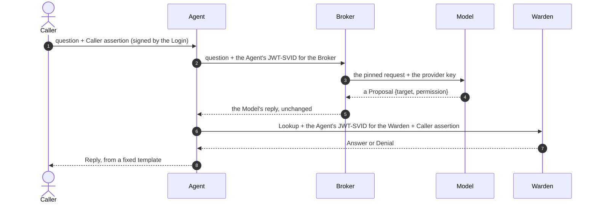

# agent-identity

A for-fun experiment in giving an AI agent its own SPIFFE identity. Terms like Agent, Warden, Caller and Proposal mean what the [glossary](GLOSSARY.md) says they mean.

## 1. What this is

You ask the Agent a question about who can do what. The Model turns your question into a Proposal (`{target, permission}`) and does nothing else. The Agent then asks the Warden one read-only Lookup, carrying two tokens: its own JWT-SVID and a Caller assertion signed by the Login. The Warden checks both and answers from fixed rules over synthetic Seed data. No model is involved in that decision. The Reply you read is a fixed template built from the Warden's Answer, never the Model's own words.

Here is a real exchange against Haiku 5.5 on the Anthropic API:

```
$ go run ./cmd/demo ask "Can Tom approve invoices?" --live --broker-url http://127.0.0.1:8787 \
    --spiffe-socket /tmp/agent-identity/permission-agent.sock --out runs/live
Yes. tom holds `invoice:approve` in acme through the Finance Approver role.
[model: anthropic/claude-haiku-5-5 via broker · id 4a02a4fd5de1bdd51a38fad0d989bf04]
```

(The Broker was started first, as a separate process; see [6. Opt-in live modes](#6-opt-in-live-modes). The run in [7. Evidence](#7-evidence) predates the Broker and used the older footer, `[model: live · …]`.)

The id in the footer is the Correlation ID, which joins the Agent's, the Broker's and the Warden's Audit records for that question (see [7. Evidence](#7-evidence)). The full design is in the [spec, #53](https://github.com/travism26/harness-lab/issues/53).

## 2. Run it

From `projects/agent-identity/`, with Go installed and nothing else:

```
go run ./cmd/demo tour
```

It runs every scenario offline in one process, with Go stand-ins for the Workload API and the Model. The Broker and the Warden are real and serve HTTP on loopback. You can see the output in [docs/evidence/tour.txt](docs/evidence/tour.txt). Each run writes its three Audit logs (the Agent's, the Broker's and the Warden's) under `runs/<UTC timestamp>/`, and the last stderr line names that directory.

## 3. How it works

One question, from start to finish:



1. The Caller asks the Agent a question. The Login has signed a Caller assertion that says who the Caller is and which Tenant they're in.
2. The Agent sends the question to the Broker. It proves who it is with a JWT-SVID from the SPIFFE Workload API. It holds no provider key.
3. The Broker checks the JWT-SVID, its allowlist and the Agent's Pin. Only then does it add the provider key and call the Model.
4. The Model proposes one `{target, permission}`. It can't decide anything else.
5. The Broker returns the Model's reply to the Agent unchanged, with the provider, the model and the cost in response headers. The Agent checks the Proposal.
6. The Agent asks the Warden one Lookup with a second JWT-SVID, minted for the Warden, and the Caller assertion.
7. The Warden checks both tokens and its rules, and answers from Seed data. No model is involved.
8. The Agent turns the Answer into a fixed-template Reply. The Model's own words never reach the Caller.

Every hop carries one Correlation ID. The Agent, the Broker and the Warden each write an Audit record under it.

The Model never sees what the Warden returns, and the Tenant and the Caller come from the Login, never from the Model ([ADR 0001](docs/adr/0001-model-only-proposes-replies-are-templates.md), [ADR 0002](docs/adr/0002-login-signs-the-caller-assertion.md)).

The Broker is the one workload that holds the provider key ([ADR 0004](docs/adr/0004-the-provider-key-lives-only-in-the-broker.md)). It checks each Model request in this order, and stops at the first failure:

1. JWT-SVID: a missing, forged, expired or wrong-audience token gets 401. The Warden's token is not accepted here, nor the Broker's at the Warden.
2. Broker allowlist: a verified workload that isn't on the list gets 403.
3. Pin: the request must match what that workload is pinned to (its model, a `max_tokens` ceiling and the hash of the rest of the request shape, system prompt and tools included), or it gets 403 `outside_pin`.
4. Only then does the Broker add the provider's auth headers and forward the request. It writes `broker.audit.jsonl` with the caller's SPIFFE ID, the model, the tokens and the cost.

The Agent's process holds no key in this mode, because the Broker runs as a separate process (see [6. Opt-in live modes](#6-opt-in-live-modes)). The stand-in tour runs a Broker in the same process as the demo, so it makes no such claim.

The Warden checks each Lookup in this order, and stops at the first failure:

1. JWT-SVID: a missing, forged, expired or wrong-audience token gets 401.
2. Agent allowlist: a verified workload that isn't on the list gets 403.
3. Caller assertion: a bad signature, expiry, an unknown Caller, or a `may_act` that names another Agent gets 401.
4. Lookup check: a Caller may ask about themself, or about someone in their own Tenant if they hold `permission:read`. Anything else is a Denial (403).
5. Only then does the Warden read the Target and the Permission. A missing Target gets the same Denial, and an unknown Permission gets 422.

[internal/warden/warden.go](internal/warden/warden.go) holds the code, and the spec's *The Lookup and the Warden's rules* section holds the reasons.

## 4. Scenarios

Run any of them with `go run ./cmd/demo <scenario>`. `tour` runs all four in order.

| Scenario | What it proves |
|---|---|
| `tokens` | The Agent's JWT-SVID gets 200, a wrong-audience one gets 401 (`jwt_svid_audience`), and a verified workload off the allowlist gets 403. |
| `scripted` | With no Model: alice asks about tom (yes), bob asks about tom (Denial, he lacks `permission:read`), and alice reaches across Tenants to `globex/sam` (Denial). `--as acme/nobody` shows a 401 for an unknown Caller. |
| `ask "<question>"` | The full path: the Model's Proposal, the Lookup and the Reply. The stand-in Model knows a fixed table of questions and answers anything else with text, which gives the `no_proposal` Reply. |
| `broker` | Four requests to the Broker: the Agent's own (200), the Warden's token (401), an unlisted workload (403) and a swapped system prompt (403 `outside_pin`). The refusals reach no Model. |

The smoke tests for these live in [cmd/demo/main_test.go](cmd/demo/main_test.go) and [cmd/demo/ask_test.go](cmd/demo/ask_test.go).

## 5. What `check` guards

[`./check`](check) runs offline, with no key and no spiffecli. It runs `gofmt`, `go vet`, staticcheck, trustlint and `go test -race -count=1 ./...`, and stops at the first failure. The trustlint analyzers in [cmd/trustlint](cmd/trustlint/main.go) enforce the trust boundaries, with their package lists in [internal/trustlint/config.go](internal/trustlint/config.go):

- **R1, Model isolation**: only the Agent and the Eval import the Model client ([modelisolation](internal/trustlint/modelisolation/modelisolation.go)).
- **R2, Warden and Broker isolation**: the Warden imports none of the Agent, the Model client and the Broker, and the Broker process (its module and `cmd/broker`) imports none of the Agent, the Warden, the Model client and the Eval, so it links only what it needs to hold the key and check a Pin ([wardenisolation](internal/trustlint/wardenisolation/wardenisolation.go)).
- **R3, no secrets in logs**: no token-typed value reaches a log or print call, and neither the Agent's nor the Broker's Audit record type can hold one ([nosecretlogs](internal/trustlint/nosecretlogs/nosecretlogs.go)).
- **R4, no insecure parse**: no go-spiffe `ParseInsecure` outside tests ([noinsecureparse](internal/trustlint/noinsecureparse/noinsecureparse.go)).
- **R5, key isolation**: outside the Broker module and the Broker command, no package references the chosen provider key (`broker.Choice.Key`, `broker.Select`), uses the `.env` loader (`broker.WithDotEnv`, `broker.DotEnvPath`), or passes `ANTHROPIC_API_KEY` or `OPENROUTER_API_KEY` as a constant to `os.Getenv`, `os.LookupEnv` or `syscall.Getenv`. The provider table holds no key variable name (`Provider.KeyEnv` is gone: the Broker keeps the names, so no package can read one from the table and pass it on; a table field named in the analyzer's `KeyRefs` is closed to every package outside the exempt ones). There are no exceptions, so the Model client has no key mode and the Eval goes through the Broker ([keyisolation](internal/trustlint/keyisolation/keyisolation.go)).

The tests also hold the evidence in place. `TestTourTranscript` compares a fresh stand-in tour with `tour.txt`, and `TestSampleRunLogs` decodes the sample logs strictly and rejects anything shaped like a JWT. Both are in [cmd/demo/evidence_test.go](cmd/demo/evidence_test.go).

## 6. Opt-in live modes

Each mode is a separate switch, and neither falls back to its stand-in. Run all commands from `projects/agent-identity/`.

**Real spiffecli** (`--spiffe-socket`). Start spiffecli by hand in its own terminal, because neither the demo nor the Broker starts or stops it:

```
mkdir -p /tmp/agent-identity
spiffecli run --config spiffecli/workloads.toml
```

Then, in another terminal:

```
go run ./cmd/demo tour --spiffe-socket /tmp/agent-identity/permission-agent.sock \
  --spiffe-socket-other /tmp/agent-identity/unlisted-agent.sock
```

The Warden takes its bundle from `/tmp/agent-identity/warden.sock`, beside the Agent's socket. Without `--spiffe-socket-other`, `tokens` skips the 403 line and prints a note. The config is [spiffecli/workloads.toml](spiffecli/workloads.toml); its `model-broker` workload is the Broker's.

**Live Model** (`--live`) goes through a Broker running as its own process, so the demo holds no key and reads neither `.env` nor any provider key variable. Run each command from `projects/agent-identity/`, in this order:

1. Start spiffecli, as above.
2. Start the Broker with the key and an `--out`. Put `ANTHROPIC_API_KEY=…` (or `OPENROUTER_API_KEY=…`) in `projects/agent-identity/.env`, which git ignores, or export it; a key in the process environment wins over the file. Only the Broker reads them.

   ```
   go run ./cmd/broker --out runs/live
   ```

   It prints the provider it chose and the URL it listens on (default `http://127.0.0.1:8787`, loopback only, `--addr` to change it). `--provider anthropic|openrouter` names one. Without it, the Broker uses Anthropic when its key is present and OpenRouter otherwise, decided once at start-up ([ADR 0003](docs/adr/0003-anthropic-api-as-a-second-model-provider.md)). A missing key for the chosen provider exits non-zero before it serves. It takes its trust bundle from `--spiffe-socket` (default `/tmp/agent-identity/model-broker.sock`) and writes `broker.audit.jsonl` into `--out` (default `runs/<UTC timestamp>/`).
3. Run the demo with the same `--out`, so the three Audit logs sit together:

   ```
   go run ./cmd/demo tour --live --broker-url http://127.0.0.1:8787 --out runs/live \
     --spiffe-socket /tmp/agent-identity/permission-agent.sock \
     --spiffe-socket-other /tmp/agent-identity/unlisted-agent.sock
   ```

   `--live` needs `--broker-url` and `--spiffe-socket`, because the Broker verifies the Agent's JWT-SVID against spiffecli's bundle. The demo's `--model` and `--provider` flags are gone; the Broker decides both. A live `tour` skips the stand-in `broker` scenario, since the real Broker owns `broker.audit.jsonl`.

The "holds no key" claim is made only for this separate-process mode. `./check` never runs it, and the [sample run](docs/evidence/sample-run/) predates it.

**The Eval** (`go run ./cmd/eval`) reaches the Model through the same Broker, under its own SPIFFE ID `model-eval`, so it holds no key and reads neither `.env` nor any provider key variable. The steps are the same three as the live tour:

1. Start spiffecli, as above (its `model-eval` workload gives the Eval its JWT-SVIDs).
2. Start the Broker with the key, as above.
3. Run the Eval against it, naming the model:

   ```
   go run ./cmd/eval --broker-url http://127.0.0.1:8787 --model claude-sonnet-5-5
   ```

   `--model` is required. The Broker holds `model-eval` to a Pin that lists Haiku, Sonnet and Opus for each provider (`claude-haiku-5-5`, `claude-sonnet-5-5`, `claude-opus-5-5` on Anthropic; `anthropic/claude-{haiku,sonnet,opus}-5.5` on OpenRouter) and refuses any other model, or none, with 403 `outside_pin`. `--spiffe-socket` defaults to `/tmp/agent-identity/model-eval.sock`. The report names the provider and model the Broker reported. `--provider` and `--env-file` are gone; the Broker decides the provider. See the [baseline report](evals/baseline-2026-11-08.md) for the sweep (it predates the Broker).

## 7. Evidence

- [docs/evidence/tour.txt](docs/evidence/tour.txt): stdout, then stderr, of the stand-in `demo tour`, with Correlation IDs, timestamps, ports and the run directory masked. Regenerate it with `go test ./cmd/demo -run TestTourTranscript -update`.
- [docs/evidence/sample-run/](docs/evidence/sample-run/): the [agent](docs/evidence/sample-run/agent.audit.jsonl) and [warden](docs/evidence/sample-run/warden.audit.jsonl) Audit logs from one live `tour --live --spiffe-socket …` run, using spiffecli 0.1.3 and Haiku 5.5 on the Anthropic API. They are copied unchanged. Its stdout matched the stand-in tour.
- [evals/baseline-2026-11-08.md](evals/baseline-2026-11-08.md): the Eval baseline.
- [docs/evidence/coverage-2026-11-08.md](docs/evidence/coverage-2026-11-08.md): statement coverage and the behaviour-to-test map.
- [docs/evidence/live-2026-11-09.md](docs/evidence/live-2026-11-09.md): a run on the real spiffecli and the live Model. Live observations and deterministic checks are kept apart.
- [docs/evidence/live-broker-2026-11-09.md](docs/evidence/live-broker-2026-11-09.md): `tour --live` and one Eval case through a separate Broker process. The demo's and the Eval's environments held no provider key. The run's three Audit logs ([live-broker-2026-11-09/](docs/evidence/live-broker-2026-11-09/)) join on Correlation IDs, and `TestLiveBrokerRunLogs` holds them.

### Following one Correlation ID

Run `grep <id> docs/evidence/sample-run/*.jsonl` to see both sides of one question:

| Case | Correlation ID | Agent record | Warden record |
|---|---|---|---|
| Answer | `74941bb83fc346d284ec2f939ce9d919` | the question, `backend: live`, `model: claude-haiku-5-5`, `proposal: {tom, invoice:approve}` on 1 attempt, `warden_status: 200`, `reply: yes`, and one `model_calls` entry with the Anthropic request id and its cost | `200 answer_yes`: the verified `agent` and `caller` (`acme/alice`), the full `target` `acme/tom`, and `role: Finance Approver` |
| Denial | `7170d5fe4bf2d537312aea2db712f677` | `caller_unverified: acme/bob`, `warden_status: 403` (a scripted Lookup, so there is no Model) | `403 denial`, `failed_check: lookup_check`: both tokens verified, but bob lacks `permission:read` |
| 401 | `05499f4ea95abda7703e384a9f1abde5` | `caller_unverified: acme/alice`, `warden_status: 401` | `401 unauthenticated`, `failed_check: jwt_svid`, `reason: jwt_svid_audience`, with no `agent` or `caller`, because neither token verified |

The Warden's record is the authoritative one. The Agent's `caller_unverified` is just the name the Agent read from the assertion without checking it.

### Eval baseline

Haiku 5.5 (`claude-haiku-5-5`), 2026-11-08, 24 cases × 3 runs:

```
category      passed/runs  accuracy  retries
named            18/18       100.0%  0
self             18/18       100.0%  0
paraphrase       18/18       100.0%  0
no-proposal      12/12       100.0%  0
multi-part        6/6        100.0%  1  (report-only, not counted)
```

Sonnet 5.5 and Opus 5.5 (report-only) also scored 100% in every category, at about 19× and 40× Haiku's cost. The [full report](evals/baseline-2026-11-08.md) has the raw numbers and the two fixes the first sweep turned up.

## 8. Limitations

- One question asks about one Permission for one person, so a two-part question gets an answer to only one part, and the Reply shows which ([`TestOneProposalForTwoPartQuestionMakesOneLookup`](internal/agent/ask_test.go)).
- The Agent gives up on the Warden after 5 seconds and records `warden_unreachable`, even if the Warden goes on to record a decision ([`TestWardenUnreachable`](internal/agent/ask_test.go)).
- The JWT-SVID and the Caller assertion each get 60 seconds of leeway past `exp`, from two different places. The JWT-SVID's is go-spiffe's own, and it reads the real clock, so a test can't move it. The Caller assertion's is checked against an injected clock ([`TestCallerAssertionClockLeeway`](internal/warden/warden_test.go), [ADR 0002](docs/adr/0002-login-signs-the-caller-assertion.md)). Clock skew beyond that leeway isn't covered, because the demo runs on one clock.
- A stolen pair of tokens can be replayed, because there's no `jti` cache, and binding the tokens with `jti`, DPoP or mTLS is out of scope. The Warden refuses any token whose `exp − iat` is over 5 minutes ([`TestExactlyMaxLifetimeTokenIsAccepted`](internal/warden/warden_test.go)). The pair is accepted until the earlier of the JWT-SVID's `exp` + 60 s and the Caller assertion's `exp` + 60 s, so at most about 6 minutes after issue, not after expiry. The two tokens need not share an issue or expiry time, and the replay is against the one audience they name.
- Replies read like templates, because they are ([ADR 0001](docs/adr/0001-model-only-proposes-replies-are-templates.md)).
- spiffecli does no workload attestation, so any process that can open a socket gets that workload's identity ([`TestSpiffecliConfig`](cmd/demo/spiffecli_test.go), [spiffecli/workloads.toml](spiffecli/workloads.toml)).
- The Login is a stand-in and the Seed data is synthetic, so nothing here is real authentication ([ADR 0002](docs/adr/0002-login-signs-the-caller-assertion.md), [internal/warden/seed.go](internal/warden/seed.go)).
- The offline tour runs everything in one Go process. Only the live Broker is a separate process, and separate Agent and Warden processes are left for a v2 ([`TestRunTour`](cmd/demo/main_test.go), spec #53 *Out of Scope*).

## 9. Decisions

- [ADR 0001](docs/adr/0001-model-only-proposes-replies-are-templates.md): the Model only proposes, and every Reply is a fixed template.
- [ADR 0002](docs/adr/0002-login-signs-the-caller-assertion.md): the Login signs the Caller assertion, so the Warden doesn't take the Agent's word for who is asking.
- [ADR 0003](docs/adr/0003-anthropic-api-as-a-second-model-provider.md): the live Model runs on the Anthropic API first, with OpenRouter as the fallback.
- [ADR 0004](docs/adr/0004-the-provider-key-lives-only-in-the-broker.md): the provider key lives only in the Broker.
- Lab-wide decisions are in [docs/adr/](../../docs/adr/).
- The [agent identity map, #28](https://github.com/travism26/harness-lab/issues/28) holds the reasoning behind every decision, and the [spec, #53](https://github.com/travism26/harness-lab/issues/53) collects the results.
